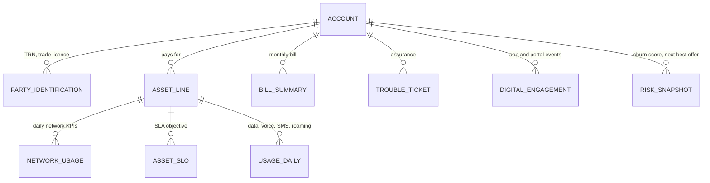

# du SMB Mobile: Data 360 demo configuration

Configuration pack for the du SMB Mobile demo (backlog foundation **F2**). It gives the `du-demo` org's Data 360 a realistic telco data layer **without any data migration**: synthetic, coherent data generated by a script and loaded through the Ingestion API.

> **Demo data only.** Every record the generator produces is synthetic. Field and object names marked **[VALIDATE]** were not confirmed against the Salesforce docs or the org and must be checked during setup.

## What is in this folder

| Path                              | Content                                                                  |
| --------------------------------- | ------------------------------------------------------------------------ |
| `ingestion/du_smb_telco.yaml`     | Ingestion API schema (OpenAPI 3.0.3), 9 objects                          |
| `mapping/dlo_to_dmo_mapping.csv`  | Field-by-field mapping from data lake objects to data model objects      |
| `insights/*.sql`                  | Calculated-insight SQL drafts (one Account dimension each)               |
| `generator/generate_demo_data.py` | Synthetic data generator (deterministic, standard library only)          |
| `loader/load_to_data360.py`       | Bulk loader for the Ingestion API (token exchange, jobs, upload, status) |

## Data model

Standard data model objects first, custom objects only where Salesforce has no standard object. TM Forum references follow SID / Open API naming.

| Entity                                  | TM Forum reference                         | Data 360 object                                  | Type     | Source                   |
| --------------------------------------- | ------------------------------------------ | ------------------------------------------------ | -------- | ------------------------ |
| SMB company                             | TMF632 Party (Organization)                | `ssot__Account__dlm`                             | standard | existing CRM data stream |
| Trade licence, TRN                      | TMF632                                     | `ssot__PartyIdentification__dlm`                 | standard | Ingestion API `PartyId`  |
| Mobile line (MSISDN, SIM, plan)         | TMF637 Product Inventory / TMF639 Resource | `ssot__Asset__dlm` (+4 custom fields [VALIDATE]) | standard | `MobileLine`             |
| Daily network experience                | Communications category DMO                | `ssot__NetworkUsage__dlm`                        | standard | `NetworkKpiDaily`        |
| Line SLA                                | —                                          | `ssot__AssetServiceLevelObjective__dlm`          | standard | `LineSlo`                |
| Daily usage (data, voice, SMS, roaming) | TMF635 Usage                               | `du_UsageDaily__dlm`                             | custom   | `UsageDaily`             |
| Monthly bill                            | TMF678 Customer Bill                       | `du_BillSummary__dlm`                            | custom   | `BillSummary`            |
| Trouble ticket                          | TMF621 Trouble Ticket                      | `du_TroubleTicket__dlm`                          | custom   | `TroubleTicket`          |
| App and portal events                   | —                                          | `du_DigitalEngagement__dlm`                      | custom   | `DigitalEngagement`      |
| Churn score and next best offer         | —                                          | `du_AccountRiskSnapshot__dlm`                    | custom   | `AccountRiskSnapshot`    |

Mapping decisions worth knowing:

- **Lines use the standard Asset DMO.** It has `ssot__CurrentMRRAmount__c`, `ssot__SerialNumber__c` (ICCID), `ssot__UniqueIdentifier__c` (MSISDN), `ssot__ProductFamilyName__c` and lifecycle dates. It has no Account field, so the line links to the payer through `ssot__BillToAccountId__c`.
- **Network quality uses the standard Network Usage DMO** (Communications category), with all KPI fields mapped one to one.
- **Raw call records are not ingested.** Usage arrives as daily aggregates per line and service. That is realistic for a telco and keeps Data 360 credit use low.
- **CRM custom objects `du_Line_Usage__c` and `du_Bill_Summary__c` stay empty.** The demo message is "telco data lives in Data 360 and is read in place", not "copied into CRM".
- **Before mapping, install the Data Cloud Communications bundle** (Data 360 Setup, UI only). If it adds Invoice or Usage DMOs, switch the custom ones to them. The mapping file marks each candidate.

### Volumes (53 accounts, 90 days)

From a dry run with 53 accounts, of which about one third are prospects:

| Object              | Rows      | Size    |
| ------------------- | --------- | ------- |
| MobileLine          | ~450      | 0.1 MB  |
| UsageDaily          | ~120k     | 13 MB   |
| NetworkKpiDaily     | ~40k      | 8 MB    |
| BillSummary         | ~420      | 0.1 MB  |
| TroubleTicket       | ~120      | <0.1 MB |
| DigitalEngagement   | ~900      | 0.1 MB  |
| AccountRiskSnapshot | ~210      | <0.1 MB |
| LineSlo, PartyId    | ~100 each | <0.1 MB |

## Coherent demo story built into the data

Every customer account gets an archetype: **healthy** (about 50%), **watch** (30%) or **at risk** (20%). The active churn drivers of that archetype shape every signal:

| Driver          | What the data shows                                                     |
| --------------- | ----------------------------------------------------------------------- |
| Usage decline   | Data use −45% in the last 30 days                                       |
| Contract ending | Contract ends within 10–58 days                                         |
| Network         | Call drop ~1.9% (vs ~0.6%), throughput ~14 Mbps, SLO breached           |
| Tickets         | 5–11 tickets in 90 days, ~45% outside SLA, "cell congestion" root cause |
| Payment         | 8–35 days late, a suspended line                                        |
| Compare plans   | "Compare business plans" and "How to move my number" events in the app  |
| Short tenure    | Customer for under 6 months                                             |

The churn score (`AccountRiskSnapshot`) is the sum of the active driver points and rises over 6 months for at-risk accounts. A driver shown in the demo is therefore always visible in the underlying data. Use `--hero <AccountId>` to force a named account into the full at-risk storyline for the live demo.

## Identity resolution

The existing ruleset unifies accounts and individuals from the CRM stream. Add for accounts:

| Priority | Rule           | Criteria                                          |
| -------- | -------------- | ------------------------------------------------- |
| 1        | TRN            | Party Identification, exact, type `TRN`           |
| 2        | Trade licence  | Party Identification, exact, type `TRADE_LICENSE` |
| 3        | Name + emirate | Exact normalised account name and billing state   |

Party Identification rules need the same type and name constants on every source; the generator writes `TRN` and `TRADE_LICENSE` into both fields.

## Calculated insights, segment, data graph, actions

| Element                            | Definition                                                                                                                                         | Used by scenario                   |
| ---------------------------------- | -------------------------------------------------------------------------------------------------------------------------------------------------- | ---------------------------------- |
| Insights                           | `insights/*.sql`: account value, usage trend, network experience, service and payment, churn risk                                                  | 2 Account 360, 4 Analytics         |
| Segment **SG1 High-value at risk** | Churn score ≥ 65 and MRC in the top 30%                                                                                                            | 3 Churn closed loop                |
| Data action                        | When an account's churn band becomes `High` → platform event → Flow creates a retention opportunity and a task [VALIDATE names in the org]         | 3                                  |
| Data graph **du_SMB_Account_360**  | Account → Party Identification, Lines (Asset), last 30 days of Network Usage per line, Asset SLO, last 3 bills, open tickets, latest risk snapshot | 1 MCP brief, 2 Account 360, agents |
| Copy-field enrichment              | Churn score, churn band, CLV, MRC onto the CRM Account                                                                                             | List views, reports, Flow          |

The data graph is the **single grounding source** for agents and the MCP server: one call returns the whole SMB customer.

## Setup runbook

| #   | Step                                                                                      | Where                          | Notes                                                                                                                              |
| --- | ----------------------------------------------------------------------------------------- | ------------------------------ | ---------------------------------------------------------------------------------------------------------------------------------- |
| 1   | Install the Data Cloud Communications bundle                                              | Data 360 Setup (UI)            | Review the DMOs it adds before step 6                                                                                              |
| 2   | Create an Ingestion API connector `du_smb_telco` and upload `ingestion/du_smb_telco.yaml` | Data 360 Setup → Ingestion API | Objects and fields can't be removed after upload                                                                                   |
| 3   | Create one data stream per object (9)                                                     | Data Streams                   | Primary keys: `line_id`, `usage_id`, `kpi_id`, `slo_id`, `bill_id`, `party_id_key`, `ticket_id`, `event_id`, `snapshot_id`         |
| 4   | Export accounts                                                                           | CLI                            | `sf data query --query "SELECT Id, Name, Type, BillingState FROM Account" --result-format csv --target-org du-demo > accounts.csv` |
| 5   | Generate data                                                                             | CLI                            | `python3 generator/generate_demo_data.py --accounts accounts.csv --out out --as-of <today> --hero <AccountId>`                     |
| 6   | Map data lake objects to data model objects                                               | Data Model                     | Follow `mapping/dlo_to_dmo_mapping.csv`; create the 5 custom DMOs and 4 custom Asset fields                                        |
| 7   | Load                                                                                      | CLI                            | `python3 loader/load_to_data360.py --dir out --source du_smb_telco` (see the file header for the token variables)                  |
| 8   | Identity rules, then run identity resolution                                              | Identity Resolution            | Add the TRN and trade-licence rules                                                                                                |
| 9   | Calculated insights, segment, data graph, data action, copy-field enrichment              | Data 360                       | In that order                                                                                                                      |
| 10  | Check                                                                                     | Data Explorer / Query Editor   | `SELECT COUNT(*) FROM ssot__NetworkUsage__dlm` returns ~40k                                                                        |

**To refresh the demo** (for example the day before), rerun steps 5 and 7 with a new `--as-of`. The upsert on stable IDs replaces the data without creating duplicates.

## Agentforce Vibes scenario (backlog scenario 8, corrected)

Agentforce Vibes is **AI-assisted agent development in Salesforce Code Builder**: you write Agent Script with AI help, in the browser, connected to the org. It is not a UI or LWC generator, so the scenario changes:

|                         | Scenario 8 (corrected)                                                                                                                                                                                                                                                                                                                    |
| ----------------------- | ----------------------------------------------------------------------------------------------------------------------------------------------------------------------------------------------------------------------------------------------------------------------------------------------------------------------------------------- |
| Name                    | Build the Retention Advisor agent live in Vibes                                                                                                                                                                                                                                                                                           |
| Live steps              | 1. Open Code Builder in `du-demo`. 2. Prompt: "Add a topic that reads the du_SMB_Account_360 data graph for the current account and proposes the next best retention offer from the risk snapshot, with the reason." 3. Vibes generates Agent Script against the org's real objects. 4. Save and test in the browser on the hero account. |
| Message                 | From idea to a working agent change in minutes, on the customer's own data model                                                                                                                                                                                                                                                          |
| Position vs other paths | Agentforce Builder: no-code configuration. Vibes: Agent Script in the browser. Claude Code: full development with sf-skills and evaluation loops (how the rest of this demo was built)                                                                                                                                                    |
| Prerequisites           | Data graph from this pack; Vibes / Code Builder access in a Developer Edition org [VALIDATE]                                                                                                                                                                                                                                              |
| Risk and fallback       | Live generation can vary: keep a pre-authored Agent Script for the same topic and a screen recording                                                                                                                                                                                                                                      |

## Assumptions and open checks

- Plan MRCs (AED 100 / 325 / 600 / 900) and data allowances are demo assumptions read from the plan names, not du prices.
- Custom fields on the standard Asset DMO: [VALIDATE]. Fallback: custom DMO `du_MobileLine__dlm` with the same fields.
- Custom DMO field API names assumed `<field>__c` in the insight SQL: [VALIDATE] in the insight builder.
- Date functions in the insight SQL: [VALIDATE]; fallback described in `insights/README.md`.
- Data 360 limits and credits in a Developer Edition org for ~160k rows: [VALIDATE] before loading.
- The Ingestion API needs an external client app with the Data 360 scopes, per the Salesforce setup guide.
